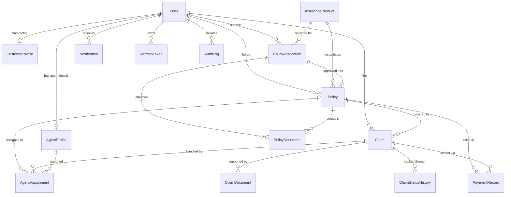

# Database Architecture & Entity Relationship Design — PostgreSQL & Prisma ORM

A comprehensive data architecture specification for the **Assurance: Insurance Policy and Claims Processing System** utilizing PostgreSQL and Prisma ORM v5.

---

## 1. Architectural Principles

1. **UUID Primary Keys**: Every database model uses cryptographically random UUIDv4 identifiers (`@default(uuid())`), eliminating enumeration attacks and facilitating distributed database scaling.
2. **ACID Relational Integrity**: Referential integrity is enforced strictly using foreign key constraints with explicit cascading policies (`CASCADE`, `RESTRICT`, `SET NULL`).
3. **High-Precision Decimal Currency**: Floating-point values are strictly forbidden for currency and coverage. PostgreSQL `DECIMAL` types with appropriate precision and scale (`DECIMAL(12, 2)`) are enforced.
4. **Immutable Audit Trails**: State transitions (e.g. claim lifecycle from `SUBMITTED` to `SETTLED`) and sensitive administrative actions are written to immutable history tables (`ClaimStatusHistory`, `AuditLog`).
5. **Session Security & Refresh Token Rotation**: Refresh tokens are stored as cryptographically hashed SHA-256 strings with revocation flags and device user-agent tracking.

---

## 2. Entity Relationship Diagram (ERD)



---

## 3. Database Enums

```prisma
enum UserRole {
  CUSTOMER
  AGENT
  CLAIMS_ADJUSTER
  ADMIN
}

enum ProductCategory {
  HEALTH
  AUTO
  HOME
  LIFE
  TRAVEL
}

enum ApplicationStatus {
  DRAFT
  SUBMITTED
  UNDER_REVIEW
  APPROVED
  REJECTED
  WITHDRAWN
}

enum PolicyStatus {
  PENDING_PAYMENT
  ACTIVE
  SUSPENDED
  EXPIRED
  CANCELLED
  CLAIMED
}

enum ClaimStatus {
  SUBMITTED
  UNDER_REVIEW
  UNDER_ASSESSMENT
  DOCUMENTS_REQUIRED
  DOCUMENTS_RESUBMITTED
  INVESTIGATION
  APPROVED
  REJECTED
  SETTLEMENT_PENDING
  SETTLED
}

enum PaymentStatus {
  PENDING
  COMPLETED
  FAILED
  REFUNDED
}

enum PaymentType {
  PREMIUM
  CLAIM_PAYOUT
  FEE
}

enum PaymentMethod {
  CREDIT_CARD
  DEBIT_CARD
  BANK_TRANSFER
  UPI
  DIGITAL_WALLET
}

enum NotificationChannel {
  IN_APP
  EMAIL
  SMS
  PUSH
}

enum DocumentType {
  ID_PROOF
  MEDICAL_REPORT
  POLICE_REPORT
  DAMAGE_PHOTO
  INVOICE
  POLICY_CONTRACT
  OTHER
}
```

---

## 4. Complete 15 Database Models

### 4.1 `User`
Central identity record for authentication and RBAC authorization.

| Column | Type | Constraints / Attributes | Description |
|---|---|---|---|
| `id` | UUID | `@id @default(uuid())` | Unique user identifier |
| `email` | String | `@unique` | Login email address |
| `passwordHash` | String | `NOT NULL` | Salted bcrypt password hash |
| `role` | UserRole | `@default(CUSTOMER)` | System role |
| `firstName` | String | `NOT NULL` | First name |
| `lastName` | String | `NOT NULL` | Family name |
| `phoneNumber` | String? | `NULLABLE` | Contact phone |
| `isActive` | Boolean | `@default(true)` | Account active flag |
| `isEmailVerified`| Boolean | `@default(false)`| Email confirmation flag |
| `createdAt` | DateTime | `@default(now())` | Account creation timestamp |
| `updatedAt` | DateTime | `@updatedAt` | Last profile update timestamp |

---

### 4.2 `CustomerProfile`
Extended demographic and underwriting data for policyholders.

| Column | Type | Constraints / Attributes | Description |
|---|---|---|---|
| `id` | UUID | `@id @default(uuid())` | Profile identifier |
| `userId` | UUID | `@unique`, FK -> `User.id` (`CASCADE`) | Owning user |
| `dateOfBirth` | DateTime? | `NULLABLE` | Customer birth date |
| `streetAddress`| String? | `NULLABLE` | Street address |
| `city` | String? | `NULLABLE` | Residential city |
| `state` | String? | `NULLABLE` | State or province |
| `postalCode` | String? | `NULLABLE` | Postal code |
| `country` | String? | `NULLABLE` | Country |
| `annualIncome` | Decimal? | `Decimal(14, 2)` | Customer declared income |
| `occupation` | String? | `NULLABLE` | Customer profession |

---

### 4.3 `AgentProfile`
Licensing and portfolio allocation data for insurance agents and adjusters.

| Column | Type | Constraints / Attributes | Description |
|---|---|---|---|
| `id` | UUID | `@id @default(uuid())` | Agent profile identifier |
| `userId` | UUID | `@unique`, FK -> `User.id` (`CASCADE`) | Owning user |
| `licenseNumber` | String | `@unique` | Regulatory broker license |
| `agencyName` | String? | `NULLABLE` | Agency affiliation |
| `specialization`| ProductCategory[] | `Array` | Insurance lines handled |
| `maxCaseload` | Int | `@default(50)` | Max concurrent active claims |
| `activeCaseload`| Int | `@default(0)` | Current active claims count |

---

### 4.4 `InsuranceProduct`
Master catalog of insurance products offered to consumers.

| Column | Type | Constraints / Attributes | Description |
|---|---|---|---|
| `id` | UUID | `@id @default(uuid())` | Product identifier |
| `code` | String | `@unique` | Product SKU (e.g. `AUTO-SHIELD-01`) |
| `name` | String | `NOT NULL` | Public product title |
| `category` | ProductCategory | `NOT NULL`, Indexed | Product category |
| `description` | String | `NOT NULL` | Coverage summary |
| `minCoverage` | Decimal | `Decimal(12, 2)` | Minimum coverage limit |
| `maxCoverage` | Decimal | `Decimal(12, 2)` | Maximum coverage limit |
| `basePremium` | Decimal | `Decimal(10, 2)` | Base rate per period |
| `standardDeductible`| Decimal | `Decimal(10, 2)` | Standard policy deductible |
| `coverageDurationMonths`| Int | `NOT NULL` | Policy duration |
| `requiredDocuments` | String[] | `Array` | Required document types |
| `termsConditions` | String | `NOT NULL` | Legal terms text |
| `isActive` | Boolean | `@default(true)` | Active offering flag |

---

### 4.5 `PolicyApplication`
Underwriting submission from customer to apply for insurance coverage.

| Column | Type | Constraints / Attributes | Description |
|---|---|---|---|
| `id` | UUID | `@id @default(uuid())` | Application identifier |
| `applicationNumber`| String | `@unique` | Reference (e.g. `APP-2026-XXXX`) |
| `userId` | UUID | FK -> `User.id` (`CASCADE`) | Submitting customer |
| `productId` | UUID | FK -> `InsuranceProduct.id` (`RESTRICT`) | Selected product |
| `coverageAmount` | Decimal | `Decimal(12, 2)` | Requested coverage |
| `premiumAmount` | Decimal | `Decimal(10, 2)` | Calculated annual premium |
| `status` | ApplicationStatus | `@default(SUBMITTED)`, Indexed | Underwriting status |
| `underwritingData`| Json | `Json` | Custom application form payload |
| `agentNotes` | String? | `NULLABLE` | Internal underwriter notes |
| `rejectionReason`| String? | `NULLABLE` | Rejection explanation |
| `submittedAt` | DateTime | `@default(now())` | Submission timestamp |

---

### 4.6 `Policy`
Binding active insurance policy contract issued upon application approval.

| Column | Type | Constraints / Attributes | Description |
|---|---|---|---|
| `id` | UUID | `@id @default(uuid())` | Policy identifier |
| `policyNumber` | String | `@unique` | Contract number (`POL-2026-XXXX`) |
| `applicationId`| UUID | `@unique`, FK -> `PolicyApplication.id` (`RESTRICT`) | Originating application |
| `userId` | UUID | FK -> `User.id` (`RESTRICT`) | Insured policyholder |
| `productId` | UUID | FK -> `InsuranceProduct.id` (`RESTRICT`) | Insurance product |
| `coverageAmount`| Decimal | `Decimal(12, 2)` | Total policy limit |
| `premiumAmount` | Decimal | `Decimal(10, 2)` | Billed premium rate |
| `deductibleAmount`| Decimal | `Decimal(10, 2)` | Out-of-pocket deductible |
| `status` | PolicyStatus | `@default(ACTIVE)`, Indexed | Current policy state |
| `startDate` | DateTime | `NOT NULL` | Coverage start date |
| `endDate` | DateTime | `NOT NULL` | Coverage expiration date |

---

### 4.7 `Claim`
Indemnity claim filed by customer against an active policy.

| Column | Type | Constraints / Attributes | Description |
|---|---|---|---|
| `id` | UUID | `@id @default(uuid())` | Claim identifier |
| `claimNumber` | String | `@unique` | Claim tracking number (`CLM-2026-XXXX`) |
| `policyId` | UUID | FK -> `Policy.id` (`RESTRICT`) | Insuring policy |
| `userId` | UUID | FK -> `User.id` (`RESTRICT`) | Claimant |
| `incidentDate` | DateTime | `NOT NULL` | Date and time of loss |
| `incidentDescription`| String | `NOT NULL` | Narrative of incident |
| `incidentLocation` | String? | `NULLABLE` | Physical location of loss |
| `claimedAmount` | Decimal | `Decimal(12, 2)` | Initial amount requested |
| `approvedAmount` | Decimal? | `Decimal(12, 2)`, `NULLABLE` | Gross amount approved |
| `deductibleAmount`| Decimal? | `Decimal(10, 2)`, `NULLABLE` | Deductible applied |
| `settlementAmount`| Decimal? | `Decimal(12, 2)`, `NULLABLE` | Net payout amount |
| `status` | ClaimStatus | `@default(SUBMITTED)`, Indexed | Current adjudication status |
| `assignedAgentId`| UUID? | FK -> `User.id` (`SET NULL`) | Dedicated adjuster |

---

### 4.8 `ClaimDocument` & 4.9 `PolicyDocument`
Secure binary file references for claims evidence and policy certificates.

| Column | Type | Constraints / Attributes | Description |
|---|---|---|---|
| `id` | UUID | `@id @default(uuid())` | Document identifier |
| `documentType`| DocumentType | `NOT NULL` | Category of document |
| `fileName` | String | `NOT NULL` | Cryptographic disk storage name |
| `originalName`| String | `NOT NULL` | Original uploaded file name |
| `mimeType` | String | `NOT NULL` | MIME type (e.g. `application/pdf`) |
| `fileSize` | Int | `NOT NULL` | Byte size |
| `storagePath` | String | `NOT NULL` | Local / S3 storage key |

---

### 4.10 `ClaimStatusHistory`
Immutable audit log of all claim status transitions.

| Column | Type | Constraints / Attributes | Description |
|---|---|---|---|
| `id` | UUID | `@id @default(uuid())` | History entry identifier |
| `claimId` | UUID | FK -> `Claim.id` (`CASCADE`) | Target claim |
| `previousStatus`| ClaimStatus | `NOT NULL` | State before change |
| `newStatus` | ClaimStatus | `NOT NULL` | State after change |
| `changedByUserId`| UUID | FK -> `User.id` (`RESTRICT`) | Actor who performed transition |
| `notes` | String? | `NULLABLE` | Explanation or adjuster comments |
| `createdAt` | DateTime | `@default(now())` | Timestamp of state change |

---

### 4.11 `Notification`
Multi-channel notification record delivered to customer or agent.

| Column | Type | Constraints / Attributes | Description |
|---|---|---|---|
| `id` | UUID | `@id @default(uuid())` | Notification identifier |
| `userId` | UUID | FK -> `User.id` (`CASCADE`) | Recipient user |
| `title` | String | `NOT NULL` | Notification headline |
| `message` | String | `NOT NULL` | Notification body |
| `channel` | NotificationChannel | `@default(IN_APP)` | Delivery medium |
| `isRead` | Boolean | `@default(false)`, Indexed | Read status flag |
| `actionUrl` | String? | `NULLABLE` | Optional deep link route |
| `createdAt` | DateTime | `@default(now())` | Notification timestamp |

---

### 4.12 `AgentAssignment`
Explicit assignment mapping between agents, policies, and claims.

| Column | Type | Constraints / Attributes | Description |
|---|---|---|---|
| `id` | UUID | `@id @default(uuid())` | Assignment identifier |
| `agentId` | UUID | FK -> `AgentProfile.id` (`CASCADE`) | Assigned agent |
| `policyId` | UUID? | FK -> `Policy.id` (`SET NULL`) | Associated policy |
| `claimId` | UUID? | FK -> `Claim.id` (`SET NULL`) | Associated claim |
| `isPrimary` | Boolean | `@default(true)` | Primary handler flag |
| `assignedAt` | DateTime | `@default(now())` | Assignment timestamp |

---

### 4.13 `PaymentRecord`
Financial ledger records capturing premium inflows and claim payout disbursements.

| Column | Type | Constraints / Attributes | Description |
|---|---|---|---|
| `id` | UUID | `@id @default(uuid())` | Payment record identifier |
| `referenceNumber`| String | `@unique` | Transaction reference (`TXN-XXXX`) |
| `policyId` | UUID? | FK -> `Policy.id` (`RESTRICT`) | Billed policy |
| `claimId` | UUID? | FK -> `Claim.id` (`RESTRICT`) | Settled claim |
| `amount` | Decimal | `Decimal(12, 2)` | Monetary value |
| `type` | PaymentType | `NOT NULL` | `PREMIUM` or `CLAIM_PAYOUT` |
| `method` | PaymentMethod | `NOT NULL` | Payment rail |
| `status` | PaymentStatus | `@default(PENDING)` | Transaction status |
| `paidAt` | DateTime? | `NULLABLE` | Completion timestamp |

---

### 4.14 `AuditLog`
System-wide immutable compliance log capturing security and state modifications.

| Column | Type | Constraints / Attributes | Description |
|---|---|---|---|
| `id` | UUID | `@id @default(uuid())` | Audit log identifier |
| `userId` | UUID? | FK -> `User.id` (`SET NULL`) | Actor who executed event |
| `action` | String | `NOT NULL`, Indexed | Event name (e.g. `CLAIM_APPROVED`) |
| `entity` | String | `NOT NULL`, Indexed | Affected table |
| `entityId` | String | `NOT NULL`, Indexed | Primary key of affected record |
| `ipAddress` | String? | `NULLABLE` | Remote caller IP |
| `payload` | Json? | `NULLABLE` | State before/after snapshot |
| `createdAt` | DateTime | `@default(now())` | Event timestamp |

---

### 4.15 `RefreshToken`
Cryptographically hashed user session tokens supporting revocation.

| Column | Type | Constraints / Attributes | Description |
|---|---|---|---|
| `id` | UUID | `@id @default(uuid())` | Session identifier |
| `userId` | UUID | FK -> `User.id` (`CASCADE`) | Session owner |
| `tokenHash` | String | `@unique` | SHA-256 hash of refresh token |
| `isRevoked` | Boolean | `@default(false)`, Indexed | Revocation status |
| `userAgent` | String? | `NULLABLE` | Client device / browser user-agent |
| `expiresAt` | DateTime | `NOT NULL`, Indexed | Session expiration |
| `createdAt` | DateTime | `@default(now())` | Token creation timestamp |

---

## 5. Performance Indexes & Composite Constraints

The schema optimizes common query paths using strategic indexes:

1. **User Lookups**:
   - `@@index([role, isActive])` — Fast filtering of active agents and administrators.
2. **Policy Applications**:
   - `@@index([userId, status])` — Accelerates customer dashboard application counts.
   - `@@index([status, createdAt])` — Accelerates agent underwriting queues.
3. **Claims Processing**:
   - `@@index([userId, status])` — Accelerates customer active claim retrieval.
   - `@@index([assignedAgentId, status])` — Optimizes agent caseload view.
   - `@@index([policyId, incidentDate])` — Prevents duplicate claims on identical incidents.
4. **Notifications**:
   - `@@index([userId, isRead])` — Instant unread badge count calculation.
5. **Session Management**:
   - `@@index([tokenHash, isRevoked])` — High-speed refresh token lookup and reuse prevention.
